<div align="center">


# SkyBridge Network

**Plataforma arcade de aviação virtual: companhias reais, freelance e voos executivos, do Cessna 172 ao 777.**

### ✈️ [flyskybridge.tech](https://flyskybridge.tech)

`Callsign: SKB` · `Site em inglês` · `Qualquer simulador, online ou offline`

[](https://github.com/alexandrefgs/skybridge-network/actions/workflows/ci.yml)
[](https://flyskybridge.tech)
[](https://discord.gg/mKTSjZntJ4)


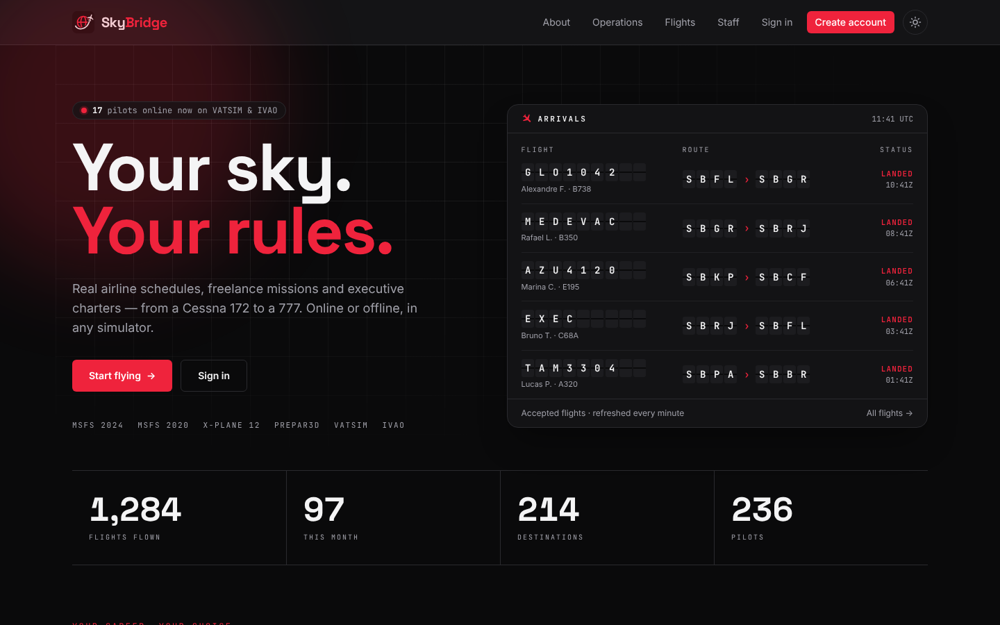

</div>

---

## Sumário

- [Sobre o projeto](#sobre-o-projeto)
- [Telas](#telas)
- [Funcionalidades](#funcionalidades)
- [Carreira do piloto](#carreira-do-piloto)
- [Regras do PIREP](#regras-do-pirep)
- [Conta, privacidade e LGPD](#conta-privacidade-e-lgpd)
- [Segurança](#segurança)
- [Identidade visual](#identidade-visual)
- [Stack](#stack)
- [Arquitetura](#arquitetura)
- [Produção](#produção)
- [Estrutura de pastas](#estrutura-de-pastas)
- [Como rodar o projeto](#como-rodar-o-projeto)
- [Testes e CI](#testes-e-ci)
- [Créditos dos dados](#créditos-dos-dados)
- [Roadmap](#roadmap)
- [Autor](#autor)

---

## Sobre o projeto

O **SkyBridge Network** é uma companhia aérea virtual para pilotos de simulador, com formato **arcade**: em vez de uma companhia só, o piloto escolhe como quer construir a carreira.

- **Freelance:** missões com história (medevac, repatriação, carga, táxi aéreo, transporte de órgãos…), passageiros com nome, carga perigosa e recompensa fixa.
- **Executiva:** fretamentos com várias pernas em jatos leves e médios.
- **Regional:** turboélices em pistas curtas e cidades pequenas.
- **Linhas aéreas:** rotas reais das companhias. As brasileiras vêm do **RPL do CGNA**, e o pagamento é por hora de voo.

As horas de voo liberam categorias maiores de aeronave, do pistão ao widebody. O piloto voa em **qualquer simulador** (MSFS 2020/2024, X-Plane, Prepar3D), **online na VATSIM ou IVAO ou offline**, planeja com o **SimBrief** e reporta cada perna com um **PIREP** revisado pelo staff.

O site está no ar em **[flyskybridge.tech](https://flyskybridge.tech)**, e a comunidade se encontra no **[Discord](https://discord.gg/mKTSjZntJ4)**.

---

## Telas

| Landing | Operations |
|---|---|
|  | 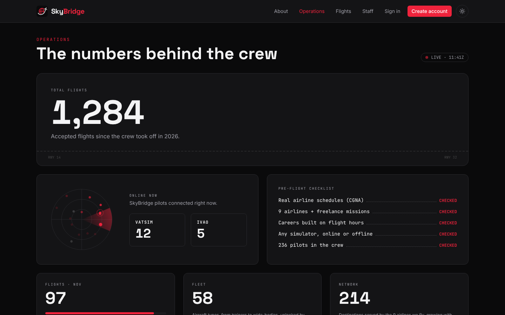 |
| **Cockpit** | **Freelance** |
| 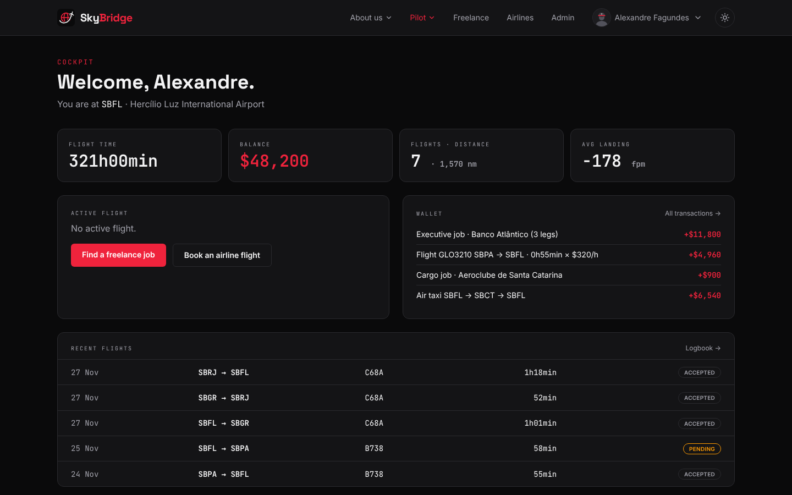 | 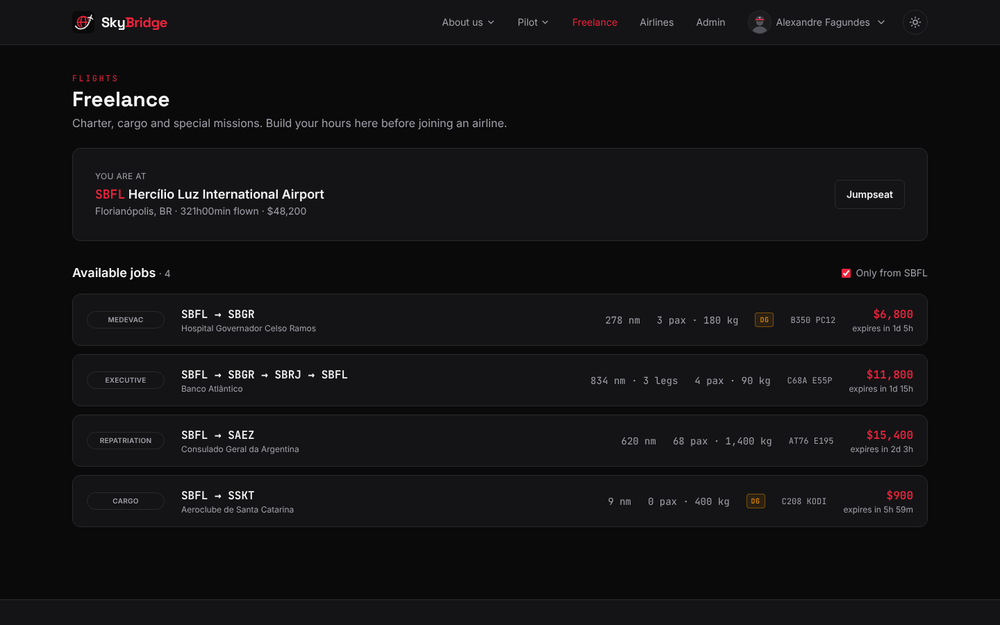 |
| **Plano de voo do SimBrief** | **Wallet** |
| 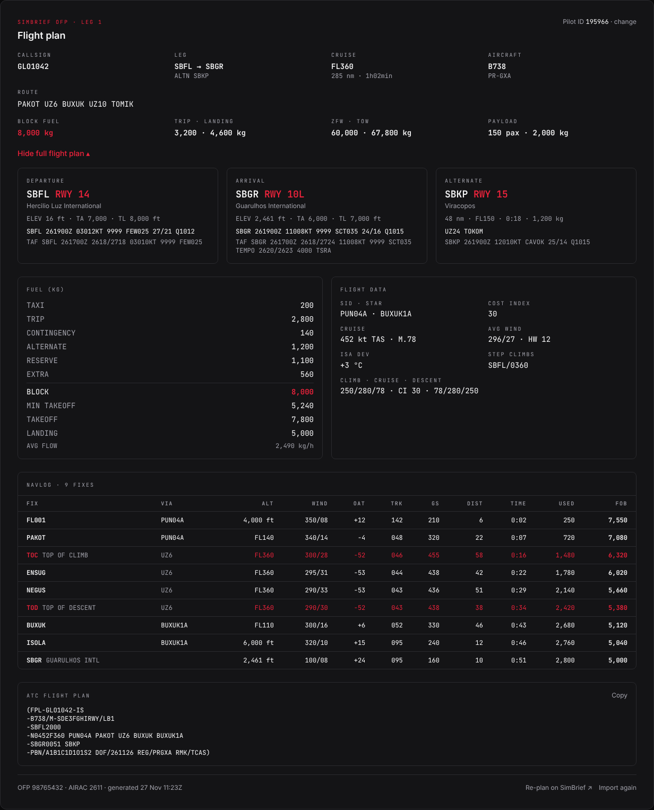 | 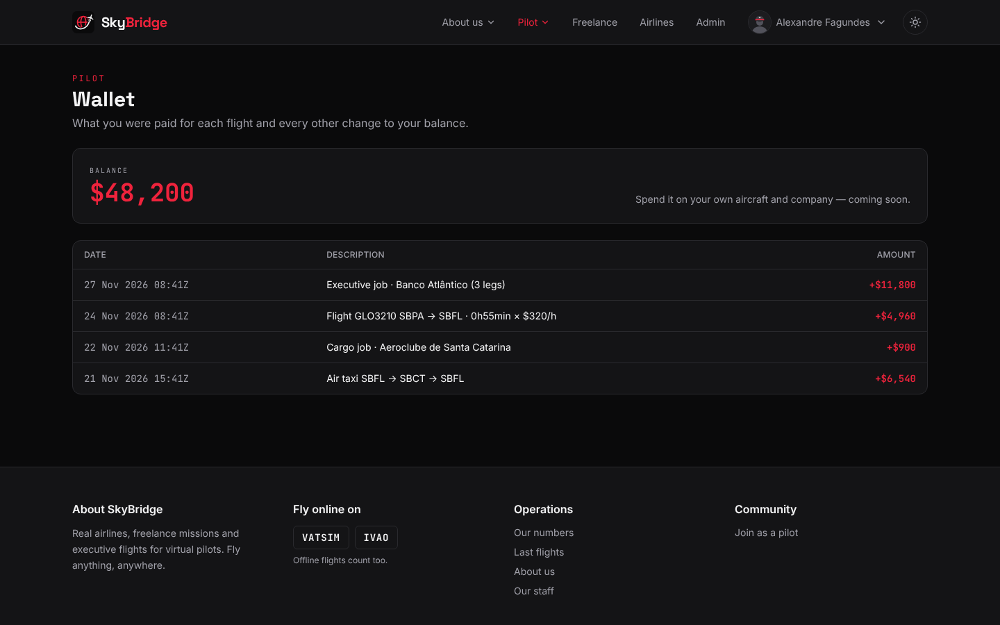 |
| **Revisão de PIREPs (staff)** | **Staff** |
| 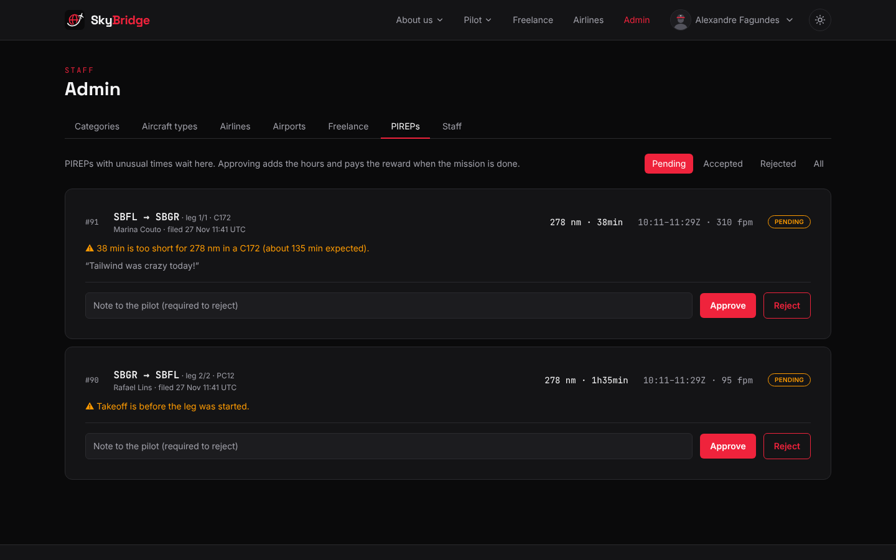 | 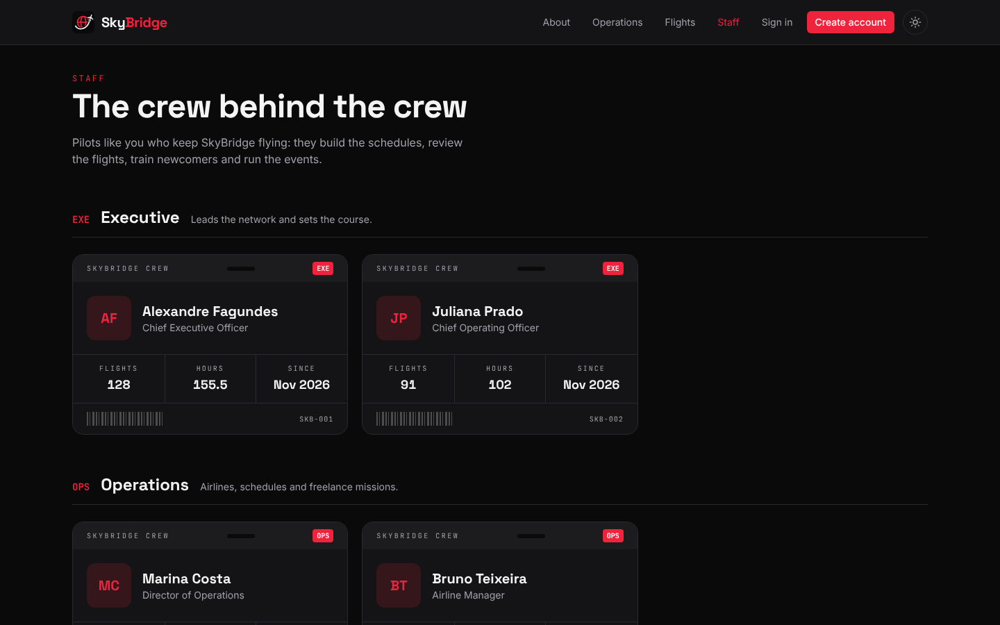 |
| **Regulations** | **Companhias** |
| 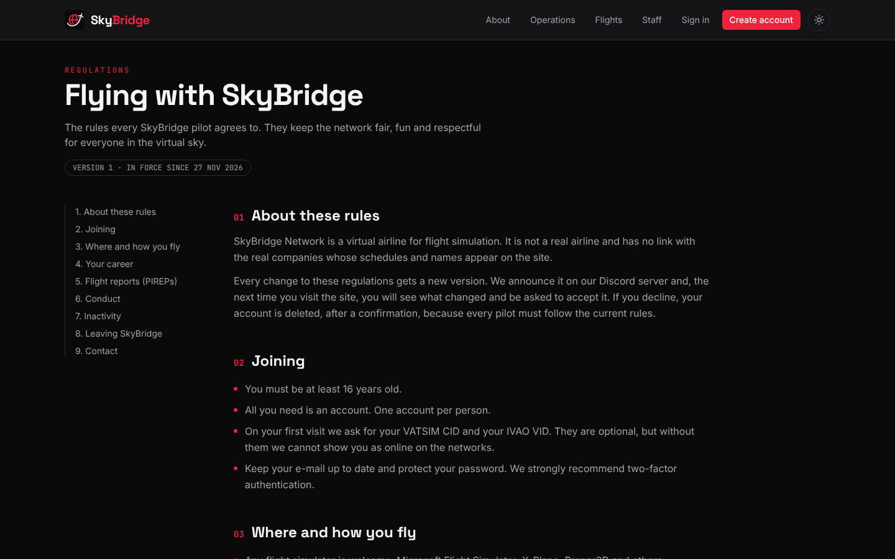 |  |

---

## Funcionalidades

### Site público
- **Landing** com painel de chegadas no estilo *split-flap* mostrando os últimos voos aceitos, números da VA e os quatro caminhos de carreira.
- **Operations:** total de voos, voos do mês, frota, destinos e um **radar** com os pilotos SkyBridge online agora na **VATSIM** e na **IVAO** (feeds públicos, cache de 1 minuto).
- **Last flights**, **About**, **Staff** (crachás por setor com voos e horas) e rodapé com Discord, Regulations e Privacy.
- **Responsivo**, com menu mobile em tela cheia no celular.

### Piloto
- **Cockpit:** horas, saldo, voos, média de pouso, voo ativo, carteira e voos recentes. Para quem está logado, o logo do site leva direto para cá.
- **Jumpseat** para trocar de aeroporto, e reserva de **um voo ativo por vez**.
- **Freelance:** quadro de missões a partir do aeroporto atual, com briefing, passageiros, carga, **carga perigosa (classe ONU)**, aeronaves permitidas e validade.
- **Linhas aéreas:** reserva das rotas reais, podendo voar **qualquer aeronave da mesma família** que a companhia opera (ex.: 737-700/800/MAX, família A320).
- **SimBrief:** importa o OFP completo (combustível, pesos, METAR/TAF, alternado, navlog, plano ATC) e mostra no layout do site.
- **PIREP** por perna, com verificação automática de tempos e **pagamento** (por hora na linha aérea, recompensa fixa no freelance). O conversor de combustível usa **AVGAS** nas aeronaves a pistão e **JET** nas demais.
- **Logbook** com mapa dos voos e filtros (30 dias, 1 ano, tudo) e **Wallet** com o extrato.
- **Perfil:** foto, SimBrief Pilot ID, **VATSIM CID / IVAO VID** (pedidos no primeiro acesso), 2FA e exclusão da conta.

### Catálogo
- **~48 mil aeroportos** do OurAirports, com **pistas** (comprimento e piso), busca e mapa.
- **9 categorias** e **47 tipos de aeronave** no seed, com alcance, cruzeiro, teto, assentos, carga e pista mínima.
- **6.160 companhias** e **~51 mil rotas** do OpenFlights, tag **Retro** e **mapa da malha** de cada companhia.
- **Sincronização com o CGNA** (RPL) para as companhias brasileiras: tipo de avião, rota ATS e FL.

### Painel do staff
| Aba | O que faz |
|---|---|
| **Categories** | Nome, horas para liberar e pagamento por hora |
| **Aircraft types** | Criar, editar e excluir tipos |
| **Airlines** | Companhias, frota, rotas (formulário, CSV ou RPL) e sync com o CGNA |
| **Airports** | Reimportar aeroportos e pistas do OurAirports |
| **Freelance** | Missões com várias pernas, aeronaves permitidas e avisos de pista e alcance |
| **PIREPs** | Aprovar ou rejeitar voos suspeitos, com nota ao piloto |
| **Staff** *(só Admin)* | Cadastrar membros por setor, ordem e acesso ao painel |

---

## Carreira do piloto

| Categoria | Horas para liberar | Pagamento por hora | Exemplos |
|---|---:|---:|---|
| Single piston | 0 h | $60 | C152, C172, SR22, DA40 |
| Twin piston | 0 h | $90 | DA62, Baron 58, Seneca V |
| Turboprop | 25 h | $130 | Caravan, Kodiak, TBM, PC-12, King Air |
| Regional | 75 h | $180 | ATR 72, Dash 8, E175, E195, CRJ900 |
| Light jet | 75 h | $170 | Phenom 100/300, HondaJet, CJ4 |
| Mid-size jet | 150 h | $220 | Latitude, Longitude, Challenger 350 |
| Large business jet | 300 h | $280 | G650ER, Global 7500, Falcon 7X |
| Medium (narrow-body) | 300 h | $320 | A320 family, 737 NG e MAX |
| Heavy (wide-body) | 600 h | $450 | A330, A350, A380, 777, 787, 747-8 |

As horas e os valores são editáveis pelo staff.

---

## Regras do PIREP

- Cada voo precisa de um **OFP do SimBrief** com a mesma origem, destino e aeronave da reserva.
- O PIREP vai para **revisão do staff** quando o tempo é curto demais para a distância (menos de 70% do esperado pelo cruzeiro da aeronave) ou quando a decolagem é anterior ao início da perna.
- Voo **rejeitado não paga e não conta horas**, e o staff explica o motivo.
- **Slew, aceleração de tempo e teletransporte** não são permitidos.

---

## Conta, privacidade e LGPD

- **Regulations** e **Privacy Policy** versionadas. Quando a versão muda, o piloto vê um popup com o que mudou e escolhe **aceitar** ou **recusar**. Recusar leva à exclusão da conta, com confirmação.
- Idade mínima de **16 anos**.
- **Inatividade:** depois de 60 dias sem acesso, a conta fica inativa. A reativação é gratuita e leva 10 minutos, com contagem regressiva controlada pelo servidor. Enquanto isso, a **API bloqueia** tudo o que não for conta, login ou configuração.
- **Retenção:** contas sem atividade por 12 meses são excluídas por um serviço em segundo plano.
- **Exclusão de conta** a qualquer momento, com senha e confirmação, apagando todos os dados (LGPD, art. 18, VI e IX).
- Sem Google Analytics, anúncios ou cookies de rastreamento. Terceiros: SimBrief, CARTO/OpenStreetMap, VATSIM e IVAO.

---

## Segurança

- **ASP.NET Core Identity** com **JWT** e roles `Pilot`, `Staff` e `Admin`.
- **Bloqueio** da conta após 5 tentativas erradas e **rate limit** de 10 requisições por minuto, por IP, em cadastro e login.
- **2FA** com app autenticador (TOTP), QR code e **códigos de recuperação**; login com seis caixas que aceitam colar e preenchimento automático.
- O token do segundo passo expira em poucos minutos e cai quando o security stamp muda.
- **Segredos nunca vão para o repositório:** em desenvolvimento ficam nos **user-secrets**; em produção, num `.env` que só existe no servidor (o repositório tem apenas o `.env.example`).
- Chaves do **Data Protection** persistidas em volume, para logins e 2FA sobreviverem a atualizações.
- Em produção: **HTTPS** automático com HSTS, firewall liberando só SSH, 80 e 443, **SSH só por chave** e banco sem porta exposta.
- Chaves da **CARTO** separadas para desenvolvimento (`localhost`) e produção (restrita ao domínio).

---

## Identidade visual

| | |
|---|---|
| **Logo** | Globo com um avião e trilha contínua |
| **Idioma do site** | Inglês |
| **Temas** | Escuro (padrão) e claro |
| **Fontes** | Space Grotesk (títulos), Inter (texto) e JetBrains Mono (ICAO, números e dados de voo) |

| Cor | Hex | Uso |
|---|---|---|
| ⬛ Fundo | `#0A0A0B` | Fundo do tema escuro |
| ⬛ Superfície | `#141416` / `#1C1C1F` | Cards, tabelas e campos |
| 🟥 Vermelho | `#EF233C` | Cor principal no tema escuro |
| 🟥 Vermelho escuro | `#D90429` | Cor principal no tema claro |
| 🟨 Âmbar | `#F59E0B` | Tag Retro, PIREP pendente e carga perigosa |
| 🟩 Verde | `#10B981` | Mensagens de sucesso |

---

## Stack

**Back-end**
- .NET 10 / ASP.NET Core Web API
- Entity Framework Core 10 + SQL Server
- ASP.NET Core Identity + JWT, 2FA (TOTP) e Data Protection
- `IMemoryCache`, `HttpClientFactory`, `TimeProvider` e `BackgroundService`
- OpenAPI + Swagger UI e health checks
- Clean Architecture

**Front-end**
- Angular 22 (standalone, signals e zoneless)
- Tailwind CSS 4
- Leaflet + mapas CARTO
- uqr (QR code do 2FA)
- Tema escuro e claro

**Testes**
- xUnit + WebApplicationFactory + **Testcontainers** (SQL Server em Docker)
- Vitest + jsdom no front

**Produção**
- Docker (imagem multi-stage) e Docker Compose
- Caddy (proxy reverso e HTTPS automático com Let's Encrypt)
- SQL Server 2022 Express em container, com backup diário
- VPS Ubuntu 24.04 (Hostinger, Campinas)
- GitHub Actions (CI)

**Integrações**
- **SimBrief** (OFP), **VATSIM** e **IVAO** (pilotos online), **OurAirports**, **OpenFlights**, **CGNA/DECEA** (RPL), **CARTO** e **OpenStreetMap**

---

## Arquitetura

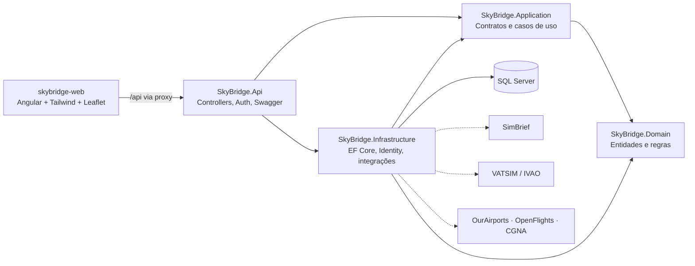

| Camada | Responsabilidade |
|---|---|
| **Domain** | Entidades e regras: aeroportos e pistas, aeronaves e famílias, companhias e rotas, reservas, missões freelance, planos de voo, PIREPs, pilotos, staff e atividade da conta |
| **Application** | Contratos, `Result<T>`, buscas paginadas, catálogo do regulamento e interfaces dos casos de uso |
| **Infrastructure** | DbContext, migrations, Identity e JWT, 2FA, seed, importadores, SimBrief, feeds da VATSIM/IVAO e o serviço de retenção |
| **Api** | Endpoints HTTP, autorização por role, filtro de conta inativa, rate limit, opções do site e Swagger; em produção, também serve o site Angular |

---

## Produção

O site roda numa VPS com quatro containers do `docker-compose.yml`. Em produção, a **API serve o próprio site Angular**, então front e API ficam na mesma origem, sem CORS.

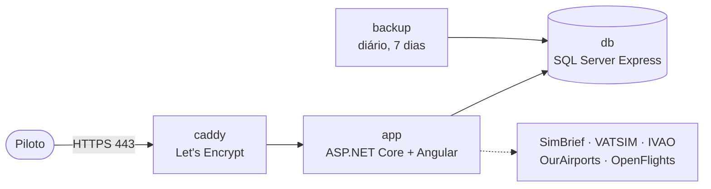

| Container | O que faz |
|---|---|
| `caddy` | Único exposto na internet; gera e renova o certificado HTTPS e redireciona o `www` |
| `app` | API + site, rodando como usuário sem privilégios; aplica as migrations na subida |
| `db` | SQL Server 2022 Express, acessível só pela rede interna do Docker |
| `backup` | `BACKUP DATABASE` uma vez por dia, guardando os últimos 7 dias |

O passo a passo completo, do servidor zerado até o site no ar (DNS, firewall, segredos, SSH, atualização e restauração de backup), está em **[docs/deploy.md](docs/deploy.md)**.

A cada push na `main`, o GitHub Actions testa tudo, monta a imagem e, se passar, **atualiza o site sozinho** por SSH, com uma chave que só consegue rodar o script de deploy. No fim, ele confere se o `/health` voltou `Healthy`.

---

## Estrutura de pastas

```
skybridge-network/
├── src/
│   ├── SkyBridge.Domain/          # Entidades e regras de negócio
│   ├── SkyBridge.Application/     # Contratos e interfaces dos casos de uso
│   ├── SkyBridge.Infrastructure/  # EF Core, Identity, integrações, seed e migrations
│   └── SkyBridge.Api/             # Controllers, Program.cs e Swagger
├── tests/
│   ├── SkyBridge.UnitTests/         # Domain, leitores CSV/RPL/OpenFlights, SimBrief e feeds
│   └── SkyBridge.IntegrationTests/  # API com SQL Server no Testcontainers
├── skybridge-web/                 # Front-end Angular
│   └── src/app/
│       ├── core/                  # auth, http, tema, config e serviços de cada área
│       ├── shared/                # mapas, layout, formulários, cards e conta
│       └── features/              # public, dashboard, flights, freelance, airlines,
│                                  # airports, aircraft, account, legal, auth e admin
├── docs/
│   ├── brand/                     # logo
│   ├── screenshots/               # prints do README
│   └── deploy.md                  # guia de deploy na VPS
├── .github/workflows/ci.yml       # CI e deploy: testes, build da imagem e atualização da VPS
├── deploy/skybridge-deploy.sh     # script que o deploy automático roda na VPS
├── Dockerfile                     # imagem de produção (Angular + .NET)
├── docker-compose.yml             # caddy, app, db e backup
├── Caddyfile                      # HTTPS e redirecionamento do www
├── .env.example                   # modelo dos segredos de produção
├── SkyBridge.slnx
└── package.json                   # scripts para rodar API + front juntos
```

---

## Como rodar o projeto

### Pré-requisitos

- [.NET SDK 10](https://dotnet.microsoft.com/download)
- [Node.js](https://nodejs.org/) 22.12+ ou 24 LTS
- SQL Server (Express, Developer ou LocalDB)
- [Docker Desktop](https://www.docker.com/products/docker-desktop/), para os testes de integração
- Ferramenta de migrations do EF Core:
  ```bash
  dotnet tool install --global dotnet-ef
  ```

### Passo a passo

**1. Clone o repositório**
```bash
git clone https://github.com/alexandrefgs/skybridge-network.git
cd skybridge-network
```

**2. Instale as dependências**
```bash
npm install
npm --prefix skybridge-web install
```

**3. Confira a conexão com o banco** em `src/SkyBridge.Api/appsettings.Development.json`:
```json
{
  "ConnectionStrings": {
    "Default": "Server=.\\SQLEXPRESS;Database=SkyBridge;Trusted_Connection=True;TrustServerCertificate=True;MultipleActiveResultSets=True"
  }
}
```
Ajuste o `Server` conforme a sua instalação: `.\\SQLEXPRESS`, `localhost` ou `(localdb)\\MSSQLLocalDB`.

**4. Configure os segredos** com user-secrets (nunca no `appsettings`):
```bash
dotnet user-secrets set "Seed:AdminEmail" "seu@email.com" --project src/SkyBridge.Api
dotnet user-secrets set "Seed:AdminPassword" "UmaSenhaForte!" --project src/SkyBridge.Api
dotnet user-secrets set "Maps:CartoApiKey" "SUA_CHAVE_DA_CARTO" --project src/SkyBridge.Api
```
- O **admin** é criado (ou recebe as roles) na subida da API em desenvolvimento.
- A chave da **CARTO** é gratuita. Sem ela, os mapas aparecem com a marca d'água *API key required*. O front busca a chave em `/api/config/client`, então ela não fica no código do Angular.

**5. Configure o site** em `src/SkyBridge.Api/appsettings.json` (não são segredos):
```json
"Site": {
  "ContactEmail": null,
  "DiscordUrl": "https://discord.gg/mKTSjZntJ4",
  "InstagramUrl": null
}
```
Um link `null` esconde o ícone no rodapé. Enquanto o `ContactEmail` estiver vazio, as páginas de Regulations e Privacy indicam o Discord como contato.

**6. Confie no certificado HTTPS de desenvolvimento** (uma vez só)
```bash
dotnet dev-certs https --trust
```

**7. Rode a API e o front juntos**
```bash
npm run dev
```
Na **primeira execução**, a API aplica as migrations e o seed (roles, categorias, tipos de aeronave e admin) e importa os aeroportos, as pistas, as companhias e as rotas. Isso leva cerca de um minuto.

| Serviço | Endereço |
|---|---|
| Site | http://localhost:4200 |
| Swagger | https://localhost:7148/swagger |
| Health check | https://localhost:7148/health |

> **Swagger com 2FA:** o `POST /api/auth/login` devolve um `twoFactorToken`. Envie esse token com o código do app em `POST /api/auth/login/2fa` para receber o `accessToken` e cole só o token no **Authorize**.

### Comandos úteis

| Comando | O que faz |
|---|---|
| `npm run dev` | Sobe API e front juntos |
| `npm run api` | Sobe só a API (com hot reload) |
| `npm run web` | Sobe só o front |
| `npm test` | Roda os testes do .NET e do front |
| `dotnet ef migrations add Nome --project src/SkyBridge.Infrastructure --startup-project src/SkyBridge.Api --output-dir Persistence/Migrations` | Cria uma migration |
| `dotnet ef database update --project src/SkyBridge.Infrastructure --startup-project src/SkyBridge.Api` | Aplica as migrations |

---

## Testes e CI

```bash
npm test
```

| Suíte | Testes |
|---|---:|
| .NET (unidade + integração) | 346 |
| Front (Vitest) | 301 |

- **Unidade (xUnit):** regras do Domain (aeronaves, pistas, reservas, PIREPs, staff, atividade da conta), leitores de CSV/RPL/OpenFlights, parser do SimBrief e dos feeds da VATSIM/IVAO.
- **Integração (xUnit + Testcontainers):** a API inteira contra um SQL Server real em Docker, cobrindo autenticação, 2FA, reservas, freelance, PIREPs, pagamentos, staff, regulamento, inatividade e exclusão de conta. **O Docker Desktop precisa estar aberto.**
- **Front (Vitest):** páginas, componentes e serviços, com `HttpTestingController` e seletores `data-testid`.
- **Produção:** um teste sobe a API em modo `Production` e confere que o site entrega os arquivos `.js` e que só as rotas do Angular caem no `index.html`.

Toda funcionalidade nova entra com testes.

A cada push na `main`, o **GitHub Actions** roda os testes da API, os testes e o build do front e o build da imagem Docker de produção. Se tudo passar, faz o **deploy** na VPS.

---

## Créditos dos dados

| Dado | Fonte | Licença |
|---|---|---|
| Aeroportos e pistas | [OurAirports](https://ourairports.com/data/) | Domínio público |
| Companhias e rotas | [OpenFlights](https://openflights.org/data) | [ODbL](https://opendatacommons.org/licenses/odbl/1-0/) |
| Rotas das companhias brasileiras | [CGNA / DECEA](https://portal.cgna.decea.mil.br/), RPL | Dados públicos |
| Planos de voo | [SimBrief](https://www.simbrief.com/) | API pública do piloto |
| Pilotos online | [VATSIM](https://vatsim.net/) e [IVAO](https://ivao.aero/) | Feeds públicos |
| Mapas | [CARTO](https://carto.com/attributions) e [OpenStreetMap](https://www.openstreetmap.org/copyright) | ODbL (dados do OSM) |

---

## Roadmap

### ✅ Fundação
- [x] Clean Architecture em .NET 10, Angular 22 + Tailwind 4, tema escuro e claro
- [x] Cadastro, login com JWT, bloqueio de conta e 2FA com códigos de recuperação

### ✅ Catálogo
- [x] Aeroportos e pistas do OurAirports, com busca e mapa
- [x] Categorias, tipos e famílias de aeronave, com pista mínima
- [x] Companhias e rotas do OpenFlights, frota, tag Retro e mapa da malha
- [x] Rotas por formulário, CSV ou RPL e sincronização com o CGNA

### ✅ Voos
- [x] Jumpseat e reserva de um voo ativo por vez
- [x] Freelance com missões de várias pernas, passageiros, carga perigosa e avisos de pista e alcance
- [x] Linhas aéreas com aeronaves da mesma família
- [x] SimBrief com OFP completo no layout do site
- [x] PIREP com verificação automática, revisão do staff e pagamento
- [x] Cockpit, Logbook e Wallet

### ✅ Site público
- [x] Landing, About, Operations com VATSIM/IVAO online, Last flights e Staff
- [x] Regulations e Privacy versionados, aceite de mudanças e exclusão de conta
- [x] Inatividade de 60 dias com reativação e retenção de 12 meses

### ✅ v1.0 no ar
- [x] Menu mobile e revisão de estados vazios, erros e responsividade
- [x] Bloqueio de conta inativa também na API
- [x] Rate limit no login e no cadastro
- [x] Docker, Caddy com HTTPS, SQL Server Express e backup diário
- [x] CI no GitHub Actions
- [x] Publicação em [flyskybridge.tech](https://flyskybridge.tech)

### 🔜 v1.1
- [ ] Limite de tamanho dos logs e monitoramento do `/health`
- [ ] E-mail de contato `@flyskybridge.tech`
- [ ] Envio de e-mails: "Esqueci a senha" e confirmação de cadastro
- [x] Deploy automático depois do CI

### 💡 Depois
- [ ] App ACARS para o simulador (FSUIPC / XPUIPC)
- [ ] Awards e perfil público do piloto
- [ ] Empresa própria, loja de aviões e manutenção
- [ ] Voar com amigos

---

## Autor

**Alexandre**, criador do SkyBridge Network

[](https://flyskybridge.tech)
[](https://discord.gg/mKTSjZntJ4)
[](https://github.com/alexandrefgs)
[](https://www.linkedin.com/in/alexandre-fgs)

---

<div align="center">

*SkyBridge Network é uma companhia aérea virtual para simulação de voo, sem vínculo com nenhuma companhia aérea real. Nomes e códigos de companhias pertencem aos seus donos.*

</div>