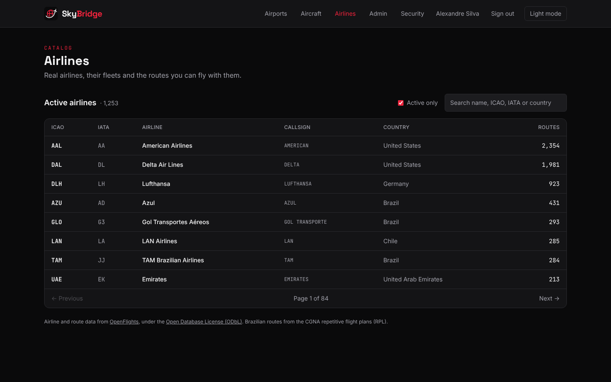
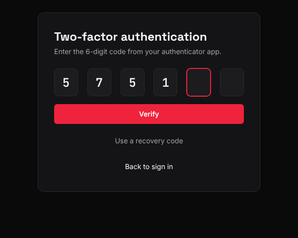
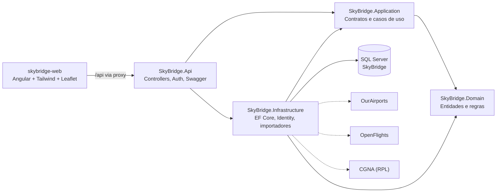

<div align="center">


# SkyBridge Network

**Plataforma arcade de aviação virtual: companhias reais, freelance, empresa própria e loja de aviões, do Cessna 172 ao 777.**

`Callsign: SKB` · `Site em inglês`


</div>

---

## Sumário

- [Sobre o projeto](#sobre-o-projeto)
- [Telas](#telas)
- [Identidade visual](#identidade-visual)
- [Segmentos do jogo](#segmentos-do-jogo)
- [Carreira do piloto](#carreira-do-piloto)
- [Catálogo](#catálogo)
- [Companhias e rotas](#companhias-e-rotas)
- [Painel do staff](#painel-do-staff)
- [Segurança](#segurança)
- [Stack](#stack)
- [Arquitetura](#arquitetura)
- [Estrutura de pastas](#estrutura-de-pastas)
- [Como rodar o projeto](#como-rodar-o-projeto)
- [Créditos dos dados](#créditos-dos-dados)
- [Roadmap](#roadmap)
- [Autor](#autor)

---

## Sobre o projeto

O **SkyBridge Network** é uma plataforma de aviação virtual para pilotos de simulador, com um formato **arcade**: em vez de uma companhia só, o piloto escolhe como quer voar.

- Voos de **companhias aéreas reais**, com rotas e frota de verdade (as brasileiras vêm do **RPL do CGNA**)
- **Freelance**: trabalhos avulsos de passageiros, carga e fretamento criados pelo staff
- **Empresa própria**: o piloto monta a sua companhia, compra aviões na **loja** e cuida da manutenção
- **Progressão por horas**: cada categoria de aeronave libera com as horas de voo, do pistão ao widebody

O sistema já reúne:

- **Cadastro aberto**, login com JWT e **autenticação em dois fatores** (app autenticador e códigos de recuperação)
- Catálogo de **48 mil aeroportos** do OurAirports, com busca e mapa
- **9 categorias de aeronave** com horas para liberar e **47 tipos** no seed, e o staff cadastra mais (alcance, cruzeiro, teto, assentos e carga)
- **6.160 companhias** do OpenFlights, com a tag **Retro** nas que não operam mais, e cerca de **51 mil rotas**
- **Sincronização com o CGNA**: as rotas reais da GOL, Azul e LATAM, com tipo de avião, rota ATS e nível de voo
- **Mapa da malha** de cada companhia: clique num aeroporto para ver as saídas e numa linha para ver a rota
- **Painel do staff** para categorias, tipos de aeronave, companhias, frotas, rotas e importação de aeroportos

Compatibilidade planejada com **MSFS 2020, MSFS 2024, X-Plane 11/12 e Prepar3D**, voando nas networks **IVAO** e **VATSIM**.

---

## Telas

| Companhias | Página da companhia |
|---|---|
|  |  |
| **Admin da companhia** | **Login com 2FA** |
|  |  |

---

## Identidade visual

| | |
|---|---|
| **Nome** | SkyBridge Network |
| **Prefixo de callsign** | `SKB`, opcional para o piloto |
| **Logo** | Globo com um avião e trilha contínua |
| **Idioma do site** | Inglês |
| **Temas** | Escuro (padrão) e claro |

### Paleta "Preto e vermelho"

| Cor | Hex | Uso |
|---|---|---|
| ⬛ Fundo | `#0A0A0B` | Fundo do tema escuro |
| ⬛ Superfície | `#141416` / `#1C1C1F` | Cards, tabelas e campos |
| 🟥 Vermelho | `#EF233C` | Cor principal no tema escuro |
| 🟥 Vermelho escuro | `#D90429` | Cor principal no tema claro |
| 🟨 Âmbar | `#F59E0B` | Tag **Retro** e destaques |
| 🟩 Verde | `#10B981` | Mensagens de sucesso |

**Fontes:** Space Grotesk (títulos), Inter (texto) e JetBrains Mono (códigos ICAO, números e dados de voo).

---

## Segmentos do jogo

| Segmento | Como funciona | Fase |
|---|---|:---:|
| **Linhas aéreas** | Voos das rotas reais das companhias, com a frota de cada uma, SimBrief e PIREP | 2 |
| **Freelance** | Trabalhos criados pelo staff, com as aeronaves permitidas em cada rota | 3 |
| **Empresa própria** | Companhia do piloto, com aviões comprados na loja e manutenção | 4 |
| **Multiplayer** | Voos e empresas em grupo | 5 |

Cada aeronave só pode estar em **um PIREP aberto por vez**.

---

## Carreira do piloto

As categorias de aeronave são liberadas pelas **horas de voo**. As horas de cada categoria podem ser editadas pelo staff.

| Categoria | Horas para liberar | Exemplos |
|---|---:|---|
| Single piston | 0 h | C152, C172, SR22, DA40 |
| Twin piston | 0 h | DA62, Baron 58, Seneca V |
| Turboprop | 25 h | Caravan, Kodiak, TBM, PC-12, King Air |
| Regional | 75 h | ATR 72, Dash 8, E175, E195, CRJ900 |
| Light jet | 75 h | Phenom 100/300, HondaJet, CJ4 |
| Mid-size jet | 150 h | Latitude, Longitude, Challenger 350 |
| Large business jet | 300 h | G650ER, Global 7500, Falcon 7X |
| Medium (narrow-body) | 300 h | A320 family, 737 NG e MAX |
| Heavy (wide-body) | 600 h | A330, A350, A380, 777, 787, 747-8 |

---

## Catálogo

O catálogo exige login. Os visitantes veem só a página inicial.

### Aeroportos

- Importados do [OurAirports](https://ourairports.com/data/): **cerca de 48 mil** aeroportos pequenos, médios e grandes. Helipontos, aeroportos fechados, bases de hidroavião e balões ficam de fora.
- A importação roda sozinha na primeira execução em desenvolvimento e pode ser repetida pelo staff em **Admin › Airports**. Ela é **idempotente**: só adiciona o que é novo e atualiza o que mudou.
- Página **Airports** com busca por ICAO, IATA, nome ou cidade, filtro por país, paginação e **mapa** com os aeroportos da página.

### Aeronaves

- **47 tipos** no seed, do C152 ao 747-8, com **alcance**, **cruzeiro**, **teto operacional**, **assentos**, **carga** e motores.
- Página **Aircraft** com a escada das 9 categorias, busca e paginação (5, 10, 20, 50 ou 100 por página).
- O staff cria, edita e exclui tipos em **Admin › Aircraft types**, com validação por campo.

---

## Companhias e rotas

### Fontes

| Fonte | O que traz |
|---|---|
| **OpenFlights** | 6.160 companhias (1.253 ativas) e cerca de 51 mil rotas sem escala, importadas na primeira execução |
| **RPL do CGNA** | Voos regulares das companhias que operam no Brasil: tipo de avião, rota ATS e nível de voo |
| **CSV** | Rotas cadastradas em lote pelo staff, para qualquer companhia |
| **Formulário** | Uma rota por vez, no Admin |

As rotas do OpenFlights são de 2014 e têm erros conhecidos. Por isso, as companhias brasileiras são sincronizadas pelo CGNA.

### Companhias

- Página **Airlines** com busca por nome, ICAO, IATA, callsign ou país, e as companhias com mais rotas primeiro. A linha inteira abre a companhia.
- Companhias que não operam mais aparecem com a tag **Retro** e ficam escondidas por padrão (**Hide retro**).
- Página da companhia com códigos, callsign, país, **frota**, data da última atualização das rotas e a lista de rotas, com distância, aeronaves, FL e rota ATS.
- **Mapa da malha:** pins em todos os aeroportos. Clicando num aeroporto aparecem as rotas que **saem** dele. Clicando numa linha, ela fica em destaque e a tabela mostra a rota nos dois sentidos. As linhas sempre seguem o lado mais curto do globo: Honolulu → Tóquio cruza o Pacífico.
- Duas companhias **ativas** não podem ter o mesmo ICAO.

### Rotas

Cada rota guarda origem, destino, **distância** (círculo máximo, em NM), **tipos de aeronave**, **rota ATS** e **nível de voo**. Uma rota é única por companhia + origem + destino.

**Importação (CSV ou RPL), sem duplicar:**

- **Rota nova:** é cadastrada.
- **Rota existente com dados diferentes:** é atualizada. Campo vazio no arquivo não apaga o que já existe.
- **Rota existente igual:** é pulada.
- **Linha com problema** (aeroporto inexistente, tipo fora do catálogo, FL inválido): é ignorada e listada no resumo com o número da linha.
- Os tipos de avião usados nas rotas entram automaticamente na **frota** da companhia.

Formato do CSV:

```csv
origin,destination,aircraft,route,fl
SBFL,SBGR,B738 B38M,NIBRU UZ171 KEVUN,370
SBGR,SBFL,B738,,
```

**Sync from CGNA:** o botão baixa o RPL atual direto do portal do CGNA (`Cia_<ICAO>_CS.txt`), procurando a edição mais recente dos últimos 14 dias. No RPL, os voos de um mesmo par de aeroportos viram uma rota só: os tipos de avião são somados, e a rota ATS e o FL vêm do voo mais frequente. O Admin mostra quando foi a **última sincronização**, a fonte e a edição do RPL.

O **FL** só é gravado quando vem de fonte real (RPL, CSV ou formulário). Nos outros casos fica em branco e o **SimBrief** escolhe o nível na hora do voo.

---

## Painel do staff

O menu **Admin** aparece para as roles **Admin** e **Staff**.

| Aba | O que faz |
|---|---|
| **Categories** | Nome e horas de cada categoria |
| **Aircraft types** | Criar, editar e excluir tipos, com validação por campo e mensagem de confirmação |
| **Airlines** | Criar companhias, editar dados e status Retro, montar a frota, cadastrar e editar rotas, importar CSV/RPL, sincronizar com o CGNA e apagar todas as rotas |
| **Airports** | Reimportar o catálogo do OurAirports |

Ações destrutivas (excluir tipo, companhia, rota ou todas as rotas) pedem confirmação.

---

## Segurança

- **ASP.NET Core Identity** com **JWT** (claims `sub`, `email`, `name` e `role`).
- **Bloqueio** da conta após 5 tentativas erradas.
- **Autenticação em dois fatores** com app autenticador (TOTP), QR code e chave manual, e **códigos de recuperação** de uso único.
- No login, o código é digitado em **seis caixas**, uma por dígito: aceita colar, preenchimento automático do celular e verifica sozinho ao completar. O botão **Use a recovery code** troca para o campo do código de recuperação.
- O token do segundo passo expira em poucos minutos e é invalidado quando o security stamp muda.
- **Segredos nunca vão para o repositório:** a senha do admin, a chave da CARTO, a futura chave do SimBrief e a chave JWT de produção ficam em **user-secrets** (ou variáveis de ambiente em produção). O `appsettings.Development.json` só tem a conexão local e a chave JWT de desenvolvimento.

---

## Stack

**Back-end**
- .NET 10 / ASP.NET Core Web API
- Entity Framework Core 10 + SQL Server
- ASP.NET Core Identity + JWT, com 2FA (TOTP) e Data Protection
- OpenAPI + Swagger UI
- Health checks
- Clean Architecture

**Front-end**
- Angular 22 (standalone, signals e zoneless)
- Tailwind CSS 4
- Leaflet + mapas CARTO
- uqr (QR code do app autenticador)
- Fontes Inter, Space Grotesk e JetBrains Mono
- Tema escuro e claro

**Testes**
- xUnit
- WebApplicationFactory + Testcontainers (SQL Server)
- Vitest + jsdom no front

**Dados e integrações**
- **OurAirports**: aeroportos
- **OpenFlights**: companhias e rotas (ODbL)
- **CGNA/DECEA**: Planos de Voo Repetitivos (RPL)
- **CARTO** e **OpenStreetMap**: mapas
- **SimBrief** (Fase 2): OFP e nível de voo

---

## Arquitetura



| Camada | Responsabilidade |
|---|---|
| **Domain** | Entidades e regras: aeroportos, categorias e tipos de aeronave, companhias, frotas, rotas, distância por círculo máximo e roles |
| **Application** | Contratos, buscas paginadas e interfaces dos casos de uso |
| **Infrastructure** | DbContext, configurações e migrations do EF Core, Identity e JWT, 2FA, seed e importadores (OurAirports, OpenFlights, RPL do CGNA e CSV) |
| **Api** | Endpoints HTTP, autorização por role, tratamento de erros e Swagger |

---

## Estrutura de pastas

```
skybridge-network/
├── src/
│   ├── SkyBridge.Domain/          # Entidades e regras de negócio
│   ├── SkyBridge.Application/     # Contratos e interfaces dos casos de uso
│   ├── SkyBridge.Infrastructure/  # EF Core, Identity, importadores, seed e migrations
│   └── SkyBridge.Api/             # Controllers, Program.cs e Swagger
├── tests/
│   ├── SkyBridge.UnitTests/         # Domain, leitores de CSV/RPL/OpenFlights e JWT
│   └── SkyBridge.IntegrationTests/  # API com SQL Server no Testcontainers
├── skybridge-web/                 # Front-end Angular
│   ├── public/                    # favicon
│   └── src/app/
│       ├── core/                  # auth, http, tema, config e serviços de cada área
│       ├── shared/                # mapas, lista de rotas, campo de código do 2FA e créditos
│       └── features/              # home, auth, account, airports, aircraft, airlines e admin
├── docs/
│   ├── brand/                     # logo
│   └── screenshots/               # prints do README
├── SkyBridge.slnx
└── package.json                   # scripts para rodar API + front juntos
```

---

## Como rodar o projeto

### Pré-requisitos

- [.NET SDK 10](https://dotnet.microsoft.com/download)
- [Node.js](https://nodejs.org/) 22.12+ ou 24 LTS
- SQL Server (Express, Developer ou LocalDB)
- [Docker Desktop](https://www.docker.com/products/docker-desktop/), só para os testes de integração
- Ferramenta de migrations do EF Core:
  ```bash
  dotnet tool install --global dotnet-ef
  ```

### Passo a passo

**1. Clone o repositório**
```bash
git clone https://github.com/alexandrefgs/skybridge-network.git
cd skybridge-network
```

**2. Instale as dependências**
```bash
npm install
npm --prefix skybridge-web install
```

**3. Confira a conexão com o banco** em `src/SkyBridge.Api/appsettings.Development.json`:
```json
{
  "ConnectionStrings": {
    "Default": "Server=.\\SQLEXPRESS;Database=SkyBridge;Trusted_Connection=True;TrustServerCertificate=True;MultipleActiveResultSets=True"
  }
}
```
Ajuste o `Server` conforme a sua instalação: `.\\SQLEXPRESS`, `localhost` ou `(localdb)\\MSSQLLocalDB`.

**4. Configure os segredos** com user-secrets (nunca no `appsettings`):
```bash
dotnet user-secrets set "Seed:AdminEmail" "seu@email.com" --project src/SkyBridge.Api
dotnet user-secrets set "Seed:AdminPassword" "UmaSenhaForte!" --project src/SkyBridge.Api
dotnet user-secrets set "Maps:CartoApiKey" "SUA_CHAVE_DA_CARTO" --project src/SkyBridge.Api
```
- O **admin** é criado (ou recebe as roles) na subida da API em desenvolvimento.
- A chave da **CARTO** é gratuita e vem por e-mail. Sem ela, os mapas aparecem com a marca d'água *API key required*. O front busca a chave em `/api/config/client`, então ela não fica no código do Angular.

**5. Confie no certificado HTTPS de desenvolvimento** (uma vez só)
```bash
dotnet dev-certs https --trust
```

**6. Rode a API e o front juntos**
```bash
npm run dev
```
A API sobe primeiro e o navegador abre o Swagger. Quando ela responde, o front sobe e abre o site.

Na **primeira execução** em desenvolvimento, a API aplica as migrations e o seed (roles, categorias, tipos de aeronave e admin) e importa os **aeroportos do OurAirports** e as **companhias e rotas do OpenFlights**. Isso leva cerca de um minuto, e o log mostra quantos registros entraram.

| Serviço | Endereço |
|---|---|
| Site | http://localhost:4200 |
| Swagger | https://localhost:7148/swagger |
| Health check | https://localhost:7148/health |

> **Swagger com 2FA:** o `POST /api/auth/login` devolve um `twoFactorToken`. Envie esse token junto com o código do app em `POST /api/auth/login/2fa` para receber o `accessToken`, e cole só o token no **Authorize**.

### Testes

```bash
npm test
```
Roda os testes do .NET (unidade e integração) e os do front. Os testes de integração sobem um SQL Server no **Docker** (Testcontainers), então o Docker Desktop precisa estar aberto. A primeira execução baixa a imagem e demora alguns minutos.

### Comandos úteis

| Comando | O que faz |
|---|---|
| `npm run dev` | Sobe API e front juntos |
| `npm run api` | Sobe só a API (com hot reload) |
| `npm run web` | Sobe só o front |
| `npm test` | Roda os testes do .NET e do front |
| `dotnet build` | Compila a solução |
| `dotnet ef migrations add Nome --project src/SkyBridge.Infrastructure --startup-project src/SkyBridge.Api --output-dir Persistence/Migrations` | Cria uma migration |

---

## Créditos dos dados

| Dado | Fonte | Licença |
|---|---|---|
| Aeroportos | [OurAirports](https://ourairports.com/data/) | Domínio público |
| Companhias e rotas | [OpenFlights](https://openflights.org/data) | [Open Database License (ODbL)](https://opendatacommons.org/licenses/odbl/1-0/) |
| Rotas das companhias brasileiras | [CGNA / DECEA](https://portal.cgna.decea.mil.br/), Planos de Voo Repetitivos (RPL) | Dados públicos |
| Mapas | [CARTO](https://carto.com/attributions) e [OpenStreetMap](https://www.openstreetmap.org/copyright) | ODbL (dados do OSM) |
| Dados das aeronaves | Especificações publicadas pelos fabricantes | Referência |

O crédito do OpenFlights e do CGNA também aparece nas páginas de companhias.

---

## Roadmap

### ✅ Fase 0: Fundação
- [x] Repositório e solução .NET 10 em Clean Architecture
- [x] Front-end Angular 22 + Tailwind CSS 4, com `features/` e testes `.spec.ts`
- [x] Identidade visual: paleta preto e vermelho, logo e favicon
- [x] Tema escuro e claro
- [x] API com Swagger, health check e redirecionamento da raiz para o Swagger
- [x] Cadastro aberto, login com JWT e bloqueio após 5 tentativas
- [x] Autenticação em dois fatores com códigos de recuperação
- [x] Login do 2FA com seis caixas e código de recuperação
- [x] API e front rodando juntos com `npm run dev`

### 🔜 Fase 1: Catálogo
- [x] Aeroportos do OurAirports com importação idempotente, busca, paginação e mapa
- [x] 9 categorias de aeronave com horas editáveis pelo staff
- [x] 47 tipos de aeronave no seed com alcance, cruzeiro, teto, assentos e carga
- [x] Catálogo só para usuários logados
- [x] Admin: categorias, tipos de aeronave e importação de aeroportos
- [x] Companhias e rotas do OpenFlights, com crédito ODbL e tag Retro
- [x] Frota por companhia
- [x] Rotas com aeronaves, rota ATS e FL, cadastradas por formulário, CSV ou RPL
- [x] Sincronização com o RPL do CGNA e registro da última sincronização
- [x] Mapa da malha com saídas por aeroporto e seleção de rota
- [ ] Pistas do OurAirports (comprimento e piso) por aeroporto
- [ ] Pista mínima por tipo de aeronave

### 🔜 Fase 2: Voos de linha
- [ ] Reserva de voos das rotas das companhias
- [ ] Voos programados do RPL (número do voo, dias e horários)
- [ ] SimBrief: OFP, rota e nível de voo
- [ ] ACARS v1 e PIREP
- [ ] Pagamento por voo
- [ ] Dashboard do piloto: números, próximo voo, carreira e mapa "My flights" (30 dias, 1 ano e todos)

### 🔜 Fase 3: Freelance
- [ ] Trabalhos criados pelo staff, com as aeronaves permitidas em cada rota
- [ ] Aviso de pista e alcance ao montar a rota
- [ ] Economia do freelance

### 🔜 Fase 4: Empresa própria
- [ ] Companhia do piloto
- [ ] Loja de aviões
- [ ] Manutenção

### 🔜 Fase 5: Multiplayer
- [ ] Voos e empresas em grupo

### 🔜 Fase 6: Mapa ao vivo e estatísticas
- [ ] Mapa dos voos em andamento
- [ ] Estatísticas e ranking

### 💡 v2
- [ ] Aplicativo desktop completo

---

## Autor

**Alexandre**, criador do SkyBridge Network

[](https://github.com/alexandrefgs)
[](https://www.linkedin.com/in/alexandre-fgs)

---

<div align="center">

*SkyBridge Network é uma plataforma de aviação virtual para simulação de voo, sem vínculo com nenhuma companhia aérea real. Nomes e códigos de companhias pertencem aos seus donos.*

</div>